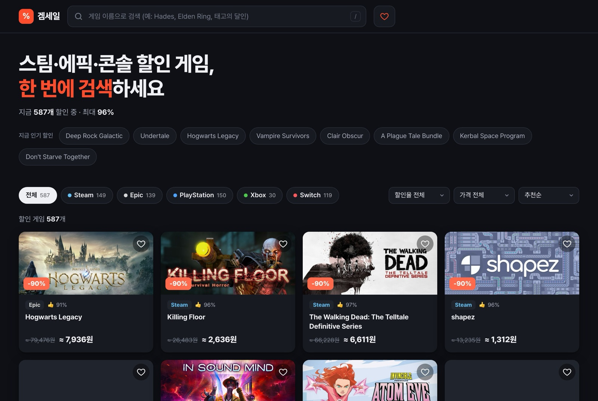
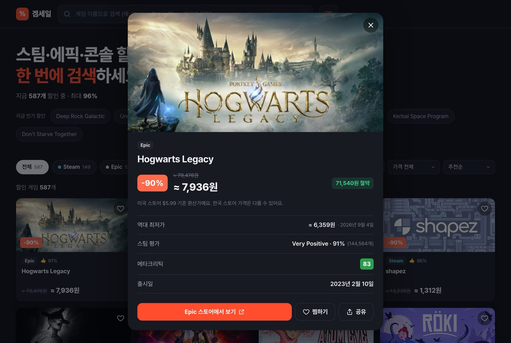
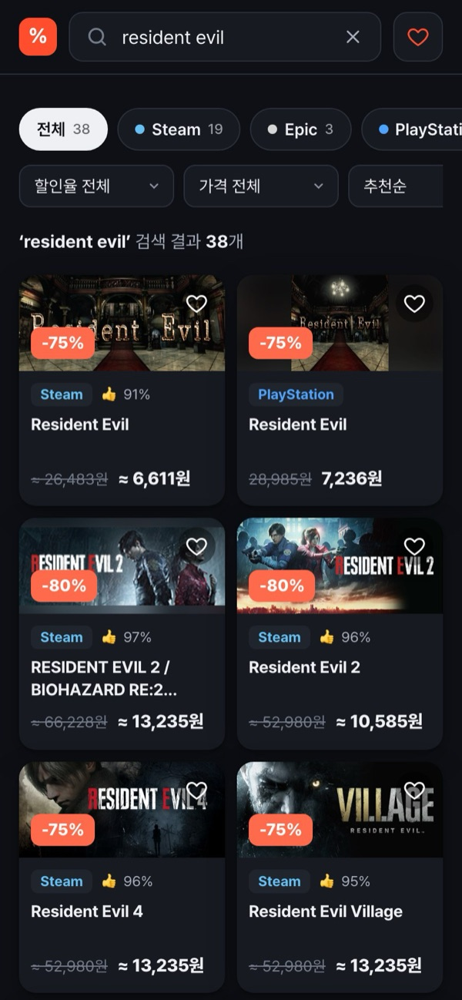

# 겜세일

Steam·Epic·Xbox·PlayStation·Nintendo Switch 할인 게임을 한 목록으로 모아 보여주는 서비스입니다. 토스 앱인토스(Apps in Toss) 미니앱으로 먼저 출시했고, 토스 밖에서도 쓸 수 있도록 할인 게임 검색 웹사이트로 확장해 함께 운영하고 있습니다. 개인 프로젝트로 기획부터 배포까지 혼자 진행했습니다.

- **웹사이트**: https://gamsale.vercel.app
- **토스 미니앱**: 토스 앱 안에서만 열립니다 (`game-deal-alert`, 버전 1.0.4, 앱인토스 SDK 3.6). 출시 1개월 오가닉 누적 이용자 250명 이상



| 게임 상세 · 역대 최저가 | 모바일 검색 |
|---|---|
|  |  |

## 주요 기능

**토스 미니앱**
- 플랫폼별/전체 할인 목록, 할인율 상위 30개는 앱을 열 때마다 순서를 섞어 노출
- 10개씩 '더보기', 처음 받은 150개를 다 보면 Steam·Epic 다음 페이지를 그때 요청
- 게임 카드 → 액션시트(스토어에서 보기 / 공유하기), 스토어 이동 전 전면 광고
- 위시리스트(기기 저장), 토스 공유 → Web Share API 순서로 공유
- 목록 중간 배너 광고, 앱 진입 시 프로모션 포인트 지급(기기당 1회)
- 닌텐도 목록의 선정성·저품질 타이틀 필터

**웹사이트**
- 게임 제목 검색: 불러온 할인 목록(콘솔 포함) + CheapShark 제목 검색으로 목록에 없는 Steam·Epic 게임 보충
- 플랫폼(여러 개 선택)·최소 할인율·최대 가격(무료만 포함)·정렬(추천/할인율/가격/할인 금액/스팀 평점/출시일/이름)
- 게임 상세: 역대 최저가와 날짜, 지금이 역대 최저가인지, 스팀 평가, 메타크리틱, 다른 스토어 가격
- 검색 조건과 열린 게임을 URL에 저장해 링크로 공유, 찜 목록·합계, 다크 모드, 모바일 레이아웃
- 성인·선정성 위주 게임 필터 (전 플랫폼·검색 결과)

## 기술 스택

TypeScript, React 18, Vite, `@apps-in-toss/web-framework`, TDS(`@toss/tds-mobile`), Vitest + Testing Library, Vercel
데이터: CheapShark API(Steam·Epic), PlayStation Store GraphQL, Microsoft Store 검색 API, 닌텐도 KR 스토어 HTML·가격 API, open.er-api(환율)

## 문제와 해결

**1. WebView에서 콘솔 스토어 API가 CORS로 막힘**
로컬에서는 Vite 프록시로 보이던 Xbox·PlayStation·Nintendo 목록이 토스 WebView에 올리면 비었습니다. 세 스토어 모두 브라우저 Origin 호출을 허용하지 않았고, CORS를 허용하는 CheapShark(Steam·Epic)만 실시간 호출이 가능했습니다.
→ `prebuild`에서 Node로 세 스토어를 받아 TypeScript 스냅샷으로 번들에 넣고, 운영 WebView는 스냅샷을 씁니다. 받아오기가 실패하면 이전 스냅샷을 그대로 둬서 빈 화면을 피합니다.
관련: `scripts/generate-deal-snapshots.mjs`, `src/features/game-deals/api/consoleSnapshots.ts`, `api/config.ts`

**2. CheapShark 요청 제한(429)**
플랫폼 전환과 '전체' 탭에서 요청이 겹치며 429가 났습니다.
→ 요청을 한 줄로 세워 800ms 간격을 두고, 같은 요청은 10분간 메모리·sessionStorage 캐시로 돌려줍니다. 429는 재시도하지 않고 바로 안내합니다(재시도가 차단을 길게 만들 수 있어서).
관련: `api/cheapSharkRequest.ts`

**3. 검수 기준에 맞춘 선정성 콘텐츠 필터**
닌텐도 KR 할인 목록에는 선정적인 저가 타이틀이 섞여 있습니다.
→ 스냅샷을 만들 때 한 번, 앱에서 읽을 때 한 번 더 거릅니다. 두 곳이 같은 규칙 파일을 import합니다(예전에는 정규식을 복사해 두었다가 규칙이 서로 달라진 적이 있습니다).
관련: `api/contentRules.js`, `api/contentFilter.ts`

**4. 광고가 스토어 이동을 막지 않게**
전면 광고를 본 뒤 스토어로 이동하는데, 광고가 로드되지 않으면 사용자가 버튼을 눌러도 아무 일도 일어나지 않을 수 있습니다.
→ 라이브 광고 ID 로드가 실패하면 테스트 ID로 한 번 바꾸고, 짧게 재시도합니다. 그래도 4초 안에 광고가 뜨지 않거나 지원하지 않는 환경이면 바로 스토어로 이동합니다.
관련: `src/features/game-deals/ads/interstitialController.ts` (동작별 테스트 포함)

**5. 토스 밖으로 — 같은 코드를 웹에 올리자 빈 화면**
미니앱 빌드를 Vercel에 그대로 배포하자 화면이 비었습니다. TDS(`@toss/tds-mobile`)가 토스와 localhost 밖의 도메인에서 실행을 막고, 토스 SDK도 WebView 밖에서 예외를 던졌습니다.
→ 데이터 로직(`src/features/game-deals/api`)만 공유하고, 웹은 진입점(`web/index.html` → `src/web`)과 빌드 설정(`vite.web.config.ts`)을 분리해 자체 UI로 만들었습니다. 웹 번들에는 TDS와 토스 SDK가 들어가지 않아 JS가 1.4MB → 312KB로 줄었습니다. 미니앱에서 호출 비용 때문에 뺐던 역대 최저가는 웹에서 **상세를 열 때만 한 번** 호출하는 방식으로 다시 넣었습니다.
관련: `vite.web.config.ts`, `src/web/data/cheapshark.ts`, `src/web/hooks/useDealDetail.ts`

더 자세한 개발 기록은 [`docs/트러블슈팅-로그.md`](./docs/트러블슈팅-로그.md)에 있습니다.

## 구조

```text
scripts/generate-deal-snapshots.mjs   # 빌드 전 콘솔 스토어 스냅샷 생성
src/features/game-deals/              # 토스 미니앱 (TDS)
├── GameDealList.tsx                  # 메인 피드 (필터, 더보기, 광고 슬롯)
├── GameDealCard.tsx / DealActionSheet.tsx
├── useGameDeals.ts / useDealPaging.ts
├── api/        # 스토어별 클라이언트, CheapShark 요청·캐시, 스냅샷, 콘텐츠 필터, 스토어 링크 — 웹과 공유
├── ads/        # 배너, 전면 광고 컨트롤러
├── promotion/  # 진입 프로모션 지급
└── wishlist/   # 찜 저장·공유
web/index.html                        # 웹사이트 진입점
src/web/                              # 웹사이트 (자체 UI)
├── App.tsx
├── components/ # 검색창, 필터, 카드, 상세, 찜 서랍
├── data/       # 검색·상세 API, 필터·정렬, 웹 전용 콘텐츠 필터
└── hooks/      # 목록 로딩, 검색, URL 상태, 상세
vite.config.ts / vite.web.config.ts / vite.proxy.ts   # 미니앱 / 웹 빌드 설정, 공용 개발 프록시
```

## 로컬 실행

Node 22에서 확인했습니다.

```bash
npm ci
npm run dev          # 미니앱 http://localhost:5173, 외부 API는 Vite 프록시로 호출
npm run dev:web      # 웹사이트 http://localhost:5174
npm test             # Vitest
npm run lint
npm run typecheck
npm run build        # prebuild(스냅샷 갱신) → vite build → ait build → game-deal-alert.ait
npm run build:web    # 웹사이트 → dist-web/
npx vercel deploy --prod
```

- `npm run build`는 스냅샷을 새로 받기 위해 네트워크가 필요합니다. 실패한 플랫폼은 이전 스냅샷을 유지합니다.
- 웹사이트의 콘솔 가격도 스냅샷을 쓰므로, 배포 전에 `npm run snapshot:deals`로 갱신하면 최신 가격이 반영됩니다.
- 광고·공유·프로모션은 토스 앱(샌드박스/QR 테스트)에서만 동작하고, 일반 브라우저에서는 건너뜁니다.

## 환경변수

모두 선택 사항입니다. 예시는 `.env.example`에 있습니다.

| 이름 | 용도 |
|---|---|
| `VITE_USD_KRW_RATE` | 환율 API 실패 시 폴백 환율 |
| `VITE_USE_CHEAPSHARK_PROXY`, `VITE_USE_NINTENDO_PROXY`, `VITE_USE_PLAYSTATION_PROXY`, `VITE_USE_XBOX_PROXY`, `VITE_USE_FX_PROXY` | 운영 빌드에서도 프록시 경로로 호출 |

광고 그룹 ID(`ads/adIds.ts`)와 프로모션 코드(`promotion/usePromotionReward.ts`)는 앱인토스 콘솔에서 발급한 식별자라 코드에 있습니다. 복제해서 쓸 때는 본인 콘솔 값으로 바꿔야 합니다.

## 한계와 다음 단계

- 콘솔 딜은 빌드 시점 데이터라 다시 빌드·배포해야 갱신됩니다. 실시간으로 바꾸려면 CORS를 대신 처리할 서버 프록시가 필요합니다.
- Steam·Epic·PlayStation·Xbox는 미국 스토어 달러 가격을 환율로 원화 환산한 값이라 한국 스토어 실제 가격과 다를 수 있습니다. 웹에서는 `≈`와 안내 문구로 표시합니다.
- 스냅샷 스크립트의 PlayStation·Xbox 파싱 로직은 아직 런타임 클라이언트와 중복돼 있습니다(콘텐츠 필터 규칙만 공유).
- 웹의 성인 콘텐츠 필터는 제목 기반이라, 새로 들어온 게임은 놓칠 수 있습니다(`src/web/data/contentFilter.ts`에 패턴 추가).
- 프로모션은 `IS_PROMOTION_TEST_PHASE` 플래그로 테스트/운영 코드를 바꾸며, 저장소의 현재 값은 `true`(테스트 코드)입니다.

## 라이선스

개인 포트폴리오 프로젝트입니다. 각 게임 스토어와 토스 관련 상표·콘텐츠의 권리는 각 권리자에게 있습니다.
